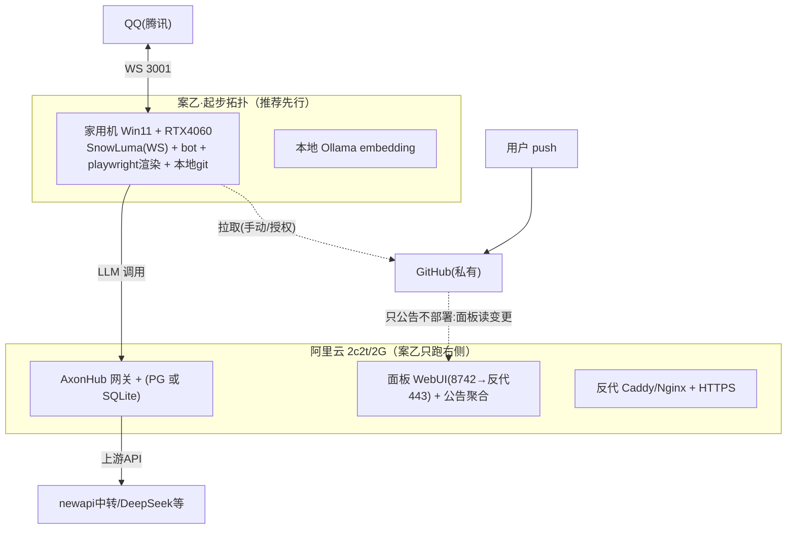

# WebUI 面板与云端部署——设计方案 + 交接文档

> 状态：**草案 v1.1（2026-10-12）**，性质＝设计文档，未实现、未派工。
> **修订 v1.1**：用户更新裁决——建站/备案/上云**搁置**（§1.1 拓扑、§3 合规、§5 预检、§6-P3 留档备查，暂不推进）；新增两条硬约束：**WebUI 性能开销必须最小化**（§2.5 预算与纪律，不得乱吃性能、不得添乱子）＋**界面必须美观、好用、顺眼、舒心**（§4C 可视化质量门槛升级为与功能同级的硬验收）。
> 上游输入：`docs/stats-analysis-report.md`（数据源与可行性矩阵，本文大量引用其证据，行号以该报告为准）。
> 用户裁决（2026-10-12）：①面板出本机，全项目压 **2c2t/2G RAM** 部署阿里云并办备案；②能热更必热更、不能的显式提示重启；③游戏百科顺序＝鸣潮→战双帕弥什→明日方舟→明日方舟：终末地；④"插件公告"按**能力域**映射（非逐插件版本）。
> 补充澄清：更新公告要让 **admin 和 bot AI 都知道**发生了什么；同时可见于 GitHub 与 WebUI；记忆图谱与知识库**全部可视化、质量不得丑陋**。

---

## 1. 架构总览

**面板＝扩展现有 control_plane WebUI，不新建系统。** 现有底座（证据见统计报告 §1.5/§1.6/§1.8）：FastAPI :8742 双令牌 Bearer + Host 白名单 + 仅环回挂载；前端 Vite+React+TanStack 已有 9 页骨架（dashboard/calls/tokens/latency/affinity/logs/knowledge/plugins/memory-graph）；`/api/v1/features` CRUD、`/api/v1/config` 读写、consent 审批双账（写账先于动手）全部在库。

### 1.1 部署拓扑（两案，先乙后甲）【v1.1 搁置：云部署与建站暂不推进，本节留档】

- **案乙（起步，推荐）**：SnowLuma+bot 留家用机（GPU 渲染、家宽 IP 对 QQ 友好、TG 直连、Windows 专项指标全保留）；云端跑 AxonHub+面板+公告聚合。**备案与公网面板在案乙即可全部完成**，价值先兑现。
- **案甲（全量上云，用户意向终态）**：SnowLuma+bot+渲染全部迁云。**过三道预检门才准迁**（见 §5 预检清单）：SnowLuma Linux 可用、RAM 基线实测 ≤ 预算、QQ 换机房 IP 试水无风控。
- TG 出口：大陆地域直连 Telegram API 不通——走既有代理出口（#71 代理面）；**勿选境外地域**（境外无法备案）。

### 1.2 请求链（面板）

浏览器 →(HTTPS/443)→ 反代 → 127.0.0.1:8742 control_plane → 双令牌 Bearer → 只读服务（webui_stats.py 范式：`mode=ro`+`query_only`）/ 写服务（consent 审批+超管令牌）。

---

## 2. 资源预算（2c2t / 2G RAM）——⚠ 全部为估算，落地前必须在现机实测 RSS 基线

| 组件 | 预算 | 依据/未知 | 降级阶梯 |
|---|---|---|---|
| Linux OS + 云监控代理 | ~300-400MB | Aliyun 裸机经验值；可卸载云监控插件省一份 | 卸非必要 agent、zram/swap 兜底 |
| Python bot（NoneBot+全域） | 400-600MB | **未知⇒预检必测**（现机 psutil/任务管理器记录稳态+峰值） | 关历史/诊断/意图遥测等非核心落库面（本就缺省关）；ANN 检索内存态待测 |
| Playwright Chromium（卡片渲染） | 300-400MB | thread-local 常驻浏览器（render_backends.py:597-602） | 渲染并发=1；`--single-process`/禁 GPU 试参；失败→纯文本兜底（链路已内建） |
| AxonHub（Go） | 50-150MB | beta10；**PG→SQLite 后端待确认**（存在 sqlite→pg 迁移先例，反推支持） | 用 SQLite 后端则省 PG 整块 |
| PostgreSQL（若保留） | 100-200MB | 小实例调优（shared_buffers 压低） | 被 SQLite 后端替代 |
| SnowLuma（协议端） | 100-200MB | Linux 版存在性**未知⇒预检第一项** | 查不到→评估替代协议端（自行调研，不在本文拍板） |
| embedding | **0（本机 Ollama 上不了云）** | 必改 | 改 OpenAI 兼容 API embedding（config 已支持自定义 base_url，现指 127.0.0.1:11434 需改） |

**合计 ≈1.3-1.9GB：紧张但可行**，前提＝三张降级牌全打（API embedding / 渲染并发 1 / AxonHub SQLite）。CPU 侧无本地推理（LLM 全走网关上游），2 vCPU 主要吃渲染截图，够用。

### 2.5 WebUI 性能与美观硬约束（v1.1 新增，适用于本地运行态——现行主口径）

**性能预算（设计门禁数字，实现时落为验收项）**：
- **服务端**：控制面+面板服务常驻 ≤ 80MB RSS、空闲 CPU≈0；单页查询瞬时 <5% 单核；主机采样 30-60s 一拍、每拍 <1% 单核；聚合查询**只打小时/日聚合表**（统计报告 §4 rollup schema），明细表查询必带时间窗+LIMIT（≤500 行/页）。
- **连接纪律**：只读连接 `mode=ro`+`query_only`（webui_stats.py 范式）；重查询进线程池、**绝不阻塞 bot 事件循环**；聚合响应 30-60s TTL 缓存（host_metrics 已有 TTL 先例 90s/30s）；日志页沿用既有 SSE 单通道，统计页默认手动刷新，自动刷新间隔 ≥30s 且可关。
- **前端**：静态产物一次构建、零服务端运行时开销；图表库按 bundle 体积选型（轻量优先；重库必须按需引入+代码分割）；表格分页/虚拟滚动，禁全量渲染；无循环动画，尊重 `prefers-reduced-motion`；首屏 gzip 产物给出门禁上限（执行方以构建实测定值，倾向 ≤300KB 不含按需图表）。
- **「不添乱子」**：面板任何故障**不得影响 bot 主链路**——读服务故障走 `source_unavailable` 信封降级（范式已在）；面板无业务库写路径；控制面关闭态零导入 fastapi/uvicorn（现状保持，`control_plane/__init__.py` 惰性导出）。

**美观要求（与性能同级的硬验收，用户原话：顺眼、舒心）**：
- 延续守岸人视觉身份：accent 色板与 QQ 卡片 `theme_tokens` 同源，让面板"像她"；
- 暗色为主、排版留白、信息密度克制、图表配色统一、空数据/加载/错误态都要有设计（不许裸报错）；
- **验收＝逐页截图评审门**：含暗色、窄窗、空数据三态，修完一轮复验通过才算收——"能跑就行"不接受。

---

## 3. 网络与合规（备案/风控/安全）【v1.1 搁置，留档】

1. **备案只管"域名建站"**：QQ（出站 WS）、TG（出站）、GitHub 都不需要。顺序＝**先用 `IP:高位端口`+强鉴权上线面板 → 购域名（国内注册商）→ 阿里云备案（约 1-2 周，期间域名不得解析建站）→ 免费 HTTPS 证书 → 切域名**。安全组只放行 443（和临时高位端口），3001/8742 等一律不公网。
2. **QQ 风控风险**：数据中心 IP 登录协议端有风控/冻结可能（未知项）。案乙天然规避；案甲迁移前必须试水（小号或观察期），并把"换 IP 必然触发重新登录"计入预案。
3. **面板安全加固（出本机的前置条件，全部必做）**：反代终止 TLS；超管令牌换强随机值并定期轮换；`_app.py` Host 白名单从 loopback 改为域名；登录失败限速已有（429），补反代层限速与访问日志；**面板不给 push/重启的执行权**（见 §4D）。

---

## 4. 功能规格（A-D 四模块）

### A. 面板基建激活（一切的前提）
开 `BOT_CONTROL_PLANE_ENABLED` → 构建 `webui/dist`（现为空，/ui 404）→ 配只读+超管双令牌 → 统计页落地（统计报告 P0/P1：账本开关、`stats_events` 明细+聚合、主机采样、告警页）。

### B. 配置中心（最大价值块）
- **模型中心**：渠道表编辑（base_url/key 引用/优先级/分组/**价格字段已有**（price_in/out/cache_read/cache_creation，model_router.py:703-750））+ 新增 `context_length`/`vendor`/说明字段（现 context 是 128K 代码常量钳制）；**必须双源对比显示**：同名条目 .env 内容字段遮蔽运行时注册表（model_router.py:1262-1307），编辑器并排展示两源值，否则"改了不生效"必现。
- **三档分层 + 生效标记**：L1 基础开关 / L2 进阶 / L3 专家（默认折叠，全局"显示全部设置"展开）；每个键一条 `effect: hot | restart` 标记——**能热更的必须走热改**（settings 运行时层 + features `hot_toggle`），标记 restart 的改动进"**待重启清单**"页（集中展示：改了什么、等重启生效）。数据结构：FeatureDescriptor 已有 `webui_visibility`/`hot_toggle`/`dependencies`（features.py:38），补 layer 与 effect 两项标注。
- **元数据标注工程**（本模块最大工作量）：为 config.py 全量 `bot_*` 键生成"人话"标注册（名称/解释/分层/生效方式/风险级）——机器生成初稿（pydantic 字段+注释）+人工复核；**同批补 `.env.example` 加键账**（#77★：增量红根因＝加键账册没跟）。
- **写路径安全**：所有写操作走 consent 审批账（写账先于动手）+ 超管令牌；改完回显"已生效/待重启"如实态（不复制 #63「批即落」谎报教训）。

### C. 内容面
- **记忆图谱**：/memory-graph 页已在（webui_memory_graph.py:54-69 ← entity_relations.py:424/440）；补**统计聚合视图**（多少人/群/对话/记忆条数、per-user 记忆列表——memory_facts/reflection_facts SQL 聚合，webui_stats 范式）。⚠ 前提：`bot_memory_bus_enabled` 缺省关，不开则图谱很薄。
- **词条审校（梗/黑话/俚语）**：接 `teaching_entries` 审批制表（teaching_service.py:245-265，pending/approved/revoked）——群聊教词 → WebUI 审校上库，闭环成立。
- **实时资讯**：news_feeds+subscribe_v2+digest 链路现成，加热搜/AI 科技/时政金融源即可；金融数值过三源硬门（规则 12）。
- **游戏百科分期同步**（用户排序）：①鸣潮 ②战双帕弥什 ③明日方舟 ④终末地（内容未成熟，缓存）。机制：bwiki 系（MediaWiki 家族）走统一 API 增量同步（recentchanges）→ 分块 → **API embedding** → kb_wiki 向量库（kb_wiki_sync 调度已注册 ROOT:2396）；非 MediaWiki 官方站逐个写适配器。红线：数值类内容 ≥3 官方源或显式标注缺口（规则 12）；溯源门（#75）＋署名来源；爬取频率克制。
- **可视化质量门槛（用户硬要求"不得丑陋"）**：图表库由执行方定（倾向 ECharts 系，暗色主题与现有前端一致）；**实现阶段验收必须含截图评审门**（逐页渲染截图→visual-judge 类评审→修完一轮再验收），不接受"能跑就行"。

### D. 项目面（公告/说明/更新流）
- **能力域公告**：域清单→简介→功能指针（投影 `docs/boards/` 板块页，一功能一目录内容已在）；全局版本=pyproject 单版本。
- **使用说明**：COMMANDS.md + boards 投影成静态页。
- **更新公告流（admin 和 AI 都知道）**：用户 push GitHub → 面板读**本地 git log**（服务器侧：定时 `git fetch` 只发现、公告"有新版本"，**不自动 pull/部署/重启**——铁律：补丁待审不自动部署，执行权永远在用户）→ 公告页展示变更；同时生成一条**更新摘要注入 bot**（走既有 digest/分区注入面），使人格"知道"最近发生了什么——这是"让 AI 也知道"的落点。服务器侧的 pull+重启做成面板上的**用户授权按钮**（点按=明示授权，带审计），默认不自动。

---

## 5. 预检清单（案甲迁移/实施前必须逐项闭环）

| # | 预检项 | 方法 | 不过的对策 |
|---|---|---|---|
| 1 | SnowLuma Linux 可用性 | 查发行版/文档/试跑 | 换协议端方案（另行调研拍板）或维持案乙 |
| 2 | 现机 RAM 基线 | psutil/任务管理器记录 bot/Chromium/AxonHub 稳态+峰值 24h | 超预算→打满 §2 三张降级牌再测 |
| 3 | AxonHub SQLite 后端支持 | 查 beta10 文档/配置项 | 不支持→留 PG 并压参数，预算重算 |
| 4 | QQ 换 DC IP 试水 | 案甲前小号/观察期验证风控 | 风控→维持案乙（SnowLuma 留家） |
| 5 | embedding API 选型 | 现有 OpenAI 兼容位直配 | 费用/延迟评估后定 |
| 6 | 域名购买与备案启动 | 阿里云备案流程 | 与 P0 并行，不阻塞 IP:端口先行 |

---

## 6. 分期计划

- **P0 面板上线（案乙即可）**：A 基建 + 统计页 + 能力域公告/使用说明（只读投影）+ 更新公告流（读侧）+ `IP:端口`强鉴权先行；备案并行启动。
- **P1 配置中心**：模型中心（含双源对比）→ 三档分层+生效标记 → 待重启清单页；元数据标注工程分批（先 L1/L2 后 L3）。
- **P2 内容面**：记忆图谱聚合 → 词条审校 → 资讯加源 → 游戏百科按用户排序分期（每期含截图评审门）。
- **P3 云迁移评估与执行（案甲）【v1.1 搁置】**：预检清单逐项闭环后迁 bot/SnowLuma；HTTPS 切域名。

---

## 7. 交接段（给执行 AI）

### 7.1 入口文件
本文档 + `docs/stats-analysis-report.md`（数据源证据与行号锚）。代码入口：`control_plane/`（_app.py 装配、api/webui.py 路由、webui_stats.py 只读范式、features.py 开关图谱、config_service.py 配置持久、consent 同意账）、`webui/src/`（前端，router.tsx+pages/）、`config.py`（全量键）、`llm_engine/model_router.py`（注册表/遮蔽语义）、`character/teaching_service.py`（词条）、`kb_wiki.py`+ROOT `_register_kb_wiki_sync_scheduler`（百科同步）、`news_feeds.py`+`subscribe_v2`（资讯）。

### 7.2 红线（违反即事故）
- 只读数据一律 `mode=ro`+`query_only` 连接（webui_stats.py 范式），禁止面板直写业务库；
- 写操作一律 consent 审批+超管令牌+如实回执（禁"批即落"谎报，#63 教训）；
- 面板无 push/自动部署/自动重启权（铁律：补丁待审不自动部署）；重启生效项必须显式标记并列待重启清单；
- 三源硬门（规则 12）对资讯与百科数值类内容适用；溯源门+来源署名（#75）；
- git 纪律：禁 `git add -A`；`.env` 真实值不入库不入聊天；新库登记 `docs/db-owners.md`；新配置键同批补 `.env.example`；
- 文档坐标纪律：行号会漂移，按符号名锚定；文档门（坐标棘轮/在飞上限）须保持绿。

### 7.3 验证要求
- 后端：四道门 `scripts/dev.ps1 -Task test|lint|typecheck|runtime-layout` 全绿（直跑 pytest 需规则 6 卫生前缀+仓外 basetemp）；
- 前端：构建产物非空 + 逐页截图评审（含暗色/窄窗），不丑门槛照 §4C 执行；
- 部署：反代后全功能回归（统计/配置读/consent 写/公告），安全组仅放行 443 与临时端口。

### 7.4 明确不做（本方案范围外）
论坛式社区互动（降级为公告页）、bot 侧自动执行 push/重启、未过预检的案甲迁移、终末地百科（等内容成熟后另立项）、**建站/备案/上云（v1.1 用户搁置，§1.1/§3/§5 留档备查）**。
