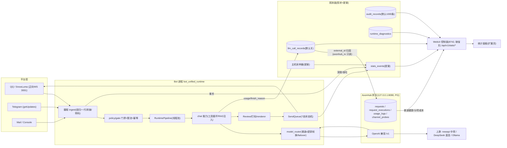

# 统计面板数据源盘点与可行性分析报告

> 生成：2026-10-12 · 性质：**只分析不实现**（schema 仅为文本提案）。
> 方法：主会话 + 10 席并行只读侦察（S1 持久层 / S2 事件层 / S3 LLM 层 / S4 平台层 / S5 网关层 / S6 主机与健康 / S7 计数器普查 / 补位A 开关缺省 / 补位B 工具·RAG·记忆 / 补位C 面板挂载与日志落盘）。证据格式 `相对路径:行号（符号）`；行号为 2026-10-12 工作树快照，漂移时以符号名为锚。
> 图例：✅ 现有数据可直接算 ｜ 🔧 需新增埋点（注明落点）｜ 📊 需引入新数据源 ｜ ❌ 不可行（注明原因）｜ ⏳ 待补位席证据复核。
> 约定：`RUN`=`plugins/bot_unified_runtime`，`CHAT`=`RUN/domains/chat_reply/capabilities/chat.py`，`LLM`=`RUN/domains/chat_reply/llm_engine`，`ROOT`=`RUN/__init__.py`。

---

## 0. 执行摘要

1. **B 类（LLM 用量/成本）几乎全绿**：计费账本 `llm_call_records`（`LLM/ledger.py:1058-1102`）已有五类 token（含 cache_read/cache_creation）、毫/微元成本、`duration_ms`、`finish_reason`、`error_kind`、`attempts_json/attempts_count`（重试全链）、`gateway_channel/gateway_latency_ms/gateway_hops_json`（AxonHub 归因列）。**核心动作只是打开 `bot_llm_billing_enabled`（缺省关，`LLM/ledger.py:54-55,91-104`）**。`llm_usage_daily`/`balance_snapshots` 两表**已建未写**（`ledger.py:1110-1140`，M1 只写明细表）。
2. **架构已定经 AxonHub 网关**：v1.0.0-beta10，`http://127.0.0.1:8090/v1`，PG 后端；bot 侧归因管道 `LLM/axonhub_attribution.py`（只读 PG 账号 axonhub_ro、fail-closed、3s 超时）已实现，开关 `bot_axonhub_attribution_enabled` 缺省关（`config.py:1770`）。渠道注册表真身＝`ChatBot_Runtime/data/settings/runtime_settings_shorekeeper.json`（生产为空 `bot_model_registry`，全表归运行时文件；渠道清单以 `scripts/configure_axonhub_registry.py` 为准）。
3. **WebUI 已存在，面板应扩页不新建**：控制面 FastAPI `127.0.0.1:8742` 仅环回（`control_plane/__init__.py:43-44`，`BOT_CONTROL_PLANE_ENABLED` 缺省关），`/api/v1` 双令牌 Bearer+Host 白名单（`control_plane/_app.py:152,695`）；既有只读统计 API `/api/v1/stats/calls|tokens|latency`、`/api/v1/affinity/board`（`api/webui.py:50-85`）+ Phase B 扩展（knowledge/plugins/memory-graph）；前端＝Vite+React+TanStack Router（`webui/src/`，9 页含 dashboard/logs-SSE），⚠ **`webui/dist/` 现为空→`/ui` 必 404，需先构建**。扩页最短路径：服务类加进 `webui_stats.py`（`mode=ro`+`query_only` 范式）→挂 `build_webui_stats_router`（webui.py:41）→`_app.py:569-577` 自动生效。范本＝`control_plane/metrics.py` 与 `control_plane/webui_stats.py`。
4. **A 类主缺口＝没有 append-only 全量消息账本**：`conversation_turns`（`character/history.py:626`）是人均 1000 条滚动裁剪窗（`history.py:580` `_prune_scope`），长窗趋势失真；门禁拒绝数据全在 `audit_records` 但**默认只留 1000 条**（`domains/ops/audit/logger.py:212,241`）。→ 本报告提出 `stats_events` 明细表（§4）。
5. **不可行/受限项**：TTFT 本地不可测（非流式，`LLM/providers.py:566-586` 无 stream 键；仅 AxonHub 回填 `ledger.py:608-609`）；"打断率"原义不存在（全仓无取消机制，S2§5；代理指标=折句率/并发率/间隔拒率）；per-API-key 用量归因（attempts 记号无键位次）。
6. **两个接线洞（缺的不是数据是接线）**：账本行 `request_id`/`capability` 全仓无 generate 调用点传参（恒空）；聊天主链传 `session_id=route_session_key` 在内容路由关时为 **空串**（`CHAT:5284-5300`）。
7. **⚠ 落库开关缺省普查（补位A/C）**：七个统计面代码缺省**不落库**——`bot_history_enabled=False`（`config.py:657`，`.env.example:264` 模板亦 false）、`bot_llm_billing_enabled=False`（`config.py:1765`）、`bot_diagnostics_enabled=False`（`config.py:662`）、`bot_web_intent_telemetry_enabled=False`（`config.py:1163`）、`bot_event_idempotency_enabled=False`（`config.py:433`）、限流 `bot_rate_limit_db_path` 空=仅内存（`config.py:1964`）、**`bot_audit_enabled=False`（`config.py:676-678`，未启用＝InMemoryAuditLogger，内存同 1000 上限）**。**生产是否在落数取决于现网 .env 实值（禁读，实施前先人工确认）**。保留窗均按**条数**不按时间（audit 1000 / diagnostics 100，逐条 prune：`ops/audit/logger.py:209-221`、`ops/smoke/diagnostics.py:408-419`）。唯一缺省即落盘的行为面＝表情回应库（`bot_reactions_enabled=True`，`config.py:1429-1435`，`data/reactions.sqlite3`，保留 90 天仅启动时 prune）。

---

## 1. 六层数据源盘点（要点浓缩）

### 1.1 持久层（S1）
- **消息/会话**：`conversation_turns`（`character/history.py:626`：request_id/platform/adapter/bot_id/session_id/sender_id/role/text/created_at + kind；索引含 created_at；写侧不截断、读侧裁剪）。**滚动裁剪人均 `bot_history_max_items`（缺省 1000）**。前提 `bot_history_enabled=True` 且 db_path 非空（`history.py:672-678`），否则 NullProvider 零落库——⚠ **该开关缺省 False（`config.py:657-658`），生产是否落数取决于现网 .env**。`campus_messages`（`domains/assistant/campus/campus_store.py:16-26`）＝唯一含群号+全文的第二张消息表（仅校园群）。
- **LLM 台账**：`llm_call_records` 全列见 §0.1；`llm_usage_daily`（按日×维度聚合，已建未写）；`balance_snapshots`（provider 余额 remaining/used/total，已建未写）；库=`data/llm_billing.sqlite3`（`ledger.py:121`），同库 co-owner `control_plane/audit.py:195-206`。
- **发送/传输**：`send_requests`（`transport/sender/queue.py:2314-2327`，state/retry_count/parts_total/parts_delivered/session_id 等）+ `send_request_parts`（:2393-2404，part 级 pending/sent/unknown/failed_final）+ `delivery_receipts`（`transport/sender/receipts.py:262-273`）。九态 ReceiptState（`domains/core/contracts/runtime.py:110-119`）。
- **用户画像**：`user_affinity`/`group_affinity`/`affinity_delta_log`/情感展示日志（`domains/chat_reply/character/affinity.py:1991/2051/2073/2117`）；`bot_mood` 单行（`character/mood.py:166-172`）；`addressing_preferences`（`character/addressing.py:280-291`）；`user_reply_policy`+`person_imagery_usage`（`character/reply_policy.py:1511-1532`）；`persona_quirks`（`character/quirks.py:212-222`）；persona/worldbook 版本库 append-only（触发器 RAISE(ABORT) 禁改删，`character/persona_service.py:154-206`）；`reflection_facts`/`memory_facts`（`character/reflection.py:304-325`、`memory.py:338-353`）。
- **行为域**：`draws` 抽卡（按人按日配额索引现成，`domains/divination/store/draw_store.py:117-145`）；`music_request_events`（requester_hash 哈希非明文 uid，`domains/music/data/music_request_store.py:96-103`，365 天滚动）；`reaction_events` 表情回应（`domains/meme/sources/reaction_store.py:18-33`）；`meme_sends`+`meme_quarantine`（`domains/meme/sources/send_history.py:74-87`）；`parse_history` 链接解析（`domains/link_parse/support/parse_history.py:19-33`）；`media_assets`/`media_archive`（`domains/media/`）。
- **运维**：`reminders`（`domains/schedule/store/reminders.py:461-473`）；`schedule_plans/occurrences/send_log`（`domains/schedule/service/schedule_store.py:29-71`，状态含 skipped/expired＝misfire 可算）；订阅 V2 九表（`domains/subscribe/store/subscription_store_v2.py:180-276`，health_state/failure_count/backoff_until/poll_log/outbox）；`result_unknown`/`error_issue`/`intent_telemetry`（`domains/ops/monitor/`）；`runtime_diagnostics` 单请求全链诊断**含 llm_usage_* token**（`domains/ops/smoke/diagnostics.py:319-360`）；consent 同意+变更双账（`domains/core/safety_exec/consent.py:564-589`）。
- **权威清单**：`docs/db-owners.md`（新库必须入册，`tests/test_db_owners_coverage.py`↔`config.py` 双锁）。

### 1.2 事件层（S2）
- `IncomingMessage`（`domains/core/contracts/runtime.py:139-215`，pydantic extra=forbid）：全字段含 `request_id`(140)/`session_type`(122: private/group/channel/email/console)/`group_id`(157)/`timestamp`(183 摄取时刻)/`message_id`(184)/`redrive_count`(206)/`debug_id`(215)；**无长度字段**（`len(plain_text)` 派生）。
- 段归一：`domains/chat_reply/ingest/message_context.py:514`，支持 text/quote/forward/face/image/file/record/video 等。
- 门禁拒绝点全枚举：`policy/gate.py:342-517`（sender_blocked/critical_input_risk/group_black1|2/group_white2_need_trigger/command_group_unlisted/long_text_soft_mention/proactive_affinity_gate/passive_group_message）+ 管线侧 `_prepare`（`domains/chat_reply/runtime/pipeline.py:1135-1333`：feature_gate/runtime_disabled/runtime_paused/policy_denied/quiet_hours_blocked/rate_limited/幂等 duplicate）+ 限流细类（`policy/rate_limit.py:969-1301` 十余种 reason）+ 安静时间（`policy/quiet_hours.py:129`）。**现状零计数器**，逐条落 `audit_records`（保留 1000）。
- 管线：`pipeline.py:966` RuntimePipeline，入口 `handle_async`:2203；**无分段计时**，但 `pipeline_result`/`transport_receipt` 日志带总 `duration_ms`（`ROOT:10451/10500`）；LLM 内部已有细粒度 `*_started` 计时点（tools/vision/asr/context/search，CHAT 各处）。
- **打断**：不存在取消机制；同会话多消息并发跑（受全局在途闸+45s 人际间隔+折句窗 `fold_inbound_turn` `ROOT:10362` 约束）。折句有日志事件 `chat_turn_folded`（`ROOT:10374`）。
- SendQueue 深度读点现成：`SQLiteSendRequestQueue.safe_summary()`（`queue.py:2278`，按 7 态 GROUP BY）；worker counters（`transport/sender/worker.py:354-410`）仅内存。

### 1.3 LLM 层（S3）
- usage **被读取并归一化落账**：`providers.py:481-524`（OpenAI/DeepSeek/Anthropic 三种 cache 字段归一；`REPORTED_TOKEN_HARD_CAP=1e7` 夹断留痕）；工具循环逐轮累加（`CHAT:4200-4223`）。
- finish_reason 归一白名单 stop/length/content_filter/tool_calls/function_call（`providers.py:117-132,525-527`）。
- **非流式**→TTFT 本地不可测；`first_token_latency_ms` 列仅 AxonHub 归因回填（`LLM/axonhub_attribution.py:54`，`ledger.py:608-609` 只补空不覆写）。
- 路由归因：`attempts_json` 记号格式表（`model_router.py:2068-2094`：`{model}:{error_kind|success}`/`failover:*`/`hedged:*`）；错误分类真身 `providers.py:365-421`（auth/rate_limited/server/network/timeout/empty_response/schema/bad_request…）；fail-fast 连续≥5 跳中止（`model_router.py:98-99`）；渠道健康 `channel_health` 表 EWMA α=0.3（`LLM/channel_health.py:179-226,301-320`）。
- 账本列语义（补位A）：`routing_group` 取值域=渠道 `group` 字段 / 固定 `default`（fallback）/ `manual`（预设）（model_router.py:655,742,1088,1118）；`attribution_status` 四态 matched/miss/unavailable/skipped（ledger.py:557-562）；`gateway_channel` 仅 matched 回填（:607），空值三义靠 status 区分；`remote_request_id`=网关响应体 id 截 128（providers.py:41,686）。前提=归因开+DB 配置非空，否则整批 skipped/unavailable。
- 多 key 轮换存在（候选渠道×密钥序，`model_router.py:2575`；auth 败即换 key `:2684-2687`），**per-key 归因无**（记号无键位次）。
- prompt 组装真身 `CHAT:3682-4010 build_chat_prompt_with_diagnostics`，**已有 16 分区字符诊断** `ChatPromptDiagnostics`（`CHAT:1002-1018,3990-4009`：section_chars/truncated_sections/total_prompt_chars）；token 估算尺现成 `_estimate_messages_tokens`（`model_router.py:141-154`，CJK≈1 字/token）。
- 空回复✅入账；拒答仅英文模板正则观测只记日志（`CHAT:4371-4406`）；重复回复无检测；主链无 JSON 输出契约。

### 1.4 平台层（S4）
- 适配器：`nonebot-adapter-onebot>=2.4.6` + `nonebot-adapter-telegram==0.1.0b20`（getUpdates 长轮询）+ mail/console；驱动 `nonebot2[fastapi]`；**仅正向 WS**（SnowLuma `ws://127.0.0.1:3001`；8080 是 bot 自身 FastAPI 口）。
- **已在消费**：`group_upload`（`ROOT:6520`）、`poke`（`ROOT:7423`）、SnowLuma 扩展 `*_msg_emoji_like`（`ROOT:7582`→`ReactionStore.record_event` 双写落库 `:7597-7609`）、`group_increase`（欢迎，`ROOT:7637`）、`group_decrease`/`group_admin`（仅日志 `ROOT:7708-7725`）。
- **零消费（面板需新增 handler）**：`friend_recall`/`group_recall`/`group_ban`/`friend_add`/notify.honor|lucky_king/全部 request/meta（heartbeat/lifecycle）/`message_sent` echo——grep 全仓零命中。
- 登录态：`driver.on_bot_connect/on_bot_disconnect` 钩子已有（`ROOT:5053-5157`，记 bot_connected/disconnected+跨渠道告警）；**心跳超时判定无**（meta 零消费，仓库侧只能 connect/disconnect 近似）；风控通知：OneBot V11 标准无此事件，SnowLuma 扩展清单仓库内不可见（unknown）。
- TG：`message_reaction` 在 0.1.0b20 被适配器 event_map 丢弃（`engine.py:14-22` 实测）→ TG 表情回应统计 ❌（待适配器升级）；edited_message/callback_query 零消费。

### 1.5 网关层（S5）
- bot→AxonHub 实锤：17 条 `axon-*` 渠道全部指向 `http://127.0.0.1:8090/v1`（`scripts/configure_axonhub_registry.py:56-135`，当时值）；「渠道选择全权归 axonhub」（`model_router.py:543`）；残余直连仅 DeepSeek 官方兜底（priority 900，:260-267）与本地 Ollama embedding（`config.py:530,536`）。
- 网关侧可得（官方文档 verified + 本机 SQL 实证）：`requests`/`request_executions`（逐跳：channel_id/status/error/latency）/`usage_logs`（total_cost/cost_items/四类 token）；`channel_model_prices` 三模式定价+版本化；`channel_probes` 健康探测；管理面 `/admin/graphql` 只认 JWT（**不建议走**）；`AH-Trace-Id` 头可归并。
- bot 侧归因管道已实现：按 `remote_request_id == requests.external_id` 反查（`axonhub_attribution.py:38-70`），回填 gateway_channel/gateway_latency_ms/gateway_hops_json/attribution_status 四态（`ledger.py:557-562`）。

### 1.6 主机与健康（S6）
- **psutil 未声明但已用**（惰性+降级设计：`domains/ops/host_metrics.py:262`、`control_plane/resources.py:24`）；pynvml/wmi/pywin32 全仓零命中；**winreg 已有两处在用**（CPU 型号 `host_metrics.py:414`、GPU 型号 `:449`）；GPU 采样两条腿已备：nvidia-smi 子进程（`:506`）+ torch CUDA 显存（`:532`）。
- 进程指标服务已有：`ResourceMetricsService`（`control_plane/resources.py:42`：cpu_time/cpu_percent/memory_bytes/thread_count/uptime_seconds；`task_count/queue_depth/database_bytes` 现为 not_connected 未接线）；API `/api/v1/metrics/resources`。
- 告警：`notify_operational_issue`（`domains/ops/monitor/alerts.py:886`）**先记账后投递**（抑制也留账）、300s 抑制窗（:177）、落点=管理员私聊+诊断卡；`result_unknown` TTL 86400。
- 崩溃守卫：`bot.py:49 _supervise_loop`（退避 5/15/60s、600s 滑窗 5 次熔断、**restarts/last_returncode/crash_times 计数在册**、`supervisor.log`:165）；faulthandler.log/crash.log（:189,198）。
- 中央调度＝nonebot-plugin-apscheduler 单例：19 处 `add_job`（`ROOT` `_register_*_scheduler` 家族 + `model_schedule.py:162`），逐 job misfire_grace_time，**无 next_run/耗时/misfire 观测账本**；`scheduler.get_jobs().next_run_time` 现成。
- 日志：生产 loguru **只挂 stdout**（`bot.py:315-322`）；轮转文件 sink `scripts/bot_log_sink.py:38` **已写好未接线**（HANDBOOK S-16：从未进过提交）；`runtime_events.log` 桥已有（`domains/ops/monitor/runtime_event_log.py:7`）；审计 JSONL tee（`domains/ops/audit/file_logger.py:25-33`）。
- Playwright：每渲染线程一个 thread-local 常驻 Chromium（`domains/render/render_backends.py:597-602`），并发 BoundedSemaphore，进程级统计对象明确。
- 管理员权限：README:35 / AGENTS 铁律（提权启动）→ WHEA/事件日志读取权限具备。

### 1.7 计数器普查（S7，三档）
- **档一可直接消费（已持久化）**：LLM 账（+聚合读口 `control_plane/metrics.py:56-110`）、订阅失败账/退避、outbox 幂等、meme 库三统计（`meme_library.py:1113-1134` stats()=total/used_total/nsfw_blocked）、consent 双账、`control_plane_audit`、`audit_records`（+JSONL tee）、features 审计（**仅 200 行滚动** `control_plane/features.py:435`）、ANN 嵌入代次盖章（`vector_knowledge.py:464-506`）、亲和度四表、`webui_stats.py` 只读聚合（=半成品面板本体）。
- **档二需补落库（内存态重启丢）**：限流桶状态（无拒绝计数）、幂等表（SQLite 版装配**默认 enabled=False** `ROOT:4691-4695`）、表情五层门 16 拒因码（`domains/meme/reactions/engine.py:607-631`，判定全内存无按码聚合）、快报源失败短账+未核实丢弃计数（`news_feeds.py:2421-2450,1469`）、渲染连续失败（`render_backends.py:829-857`）、快恢复账（`domains/ops/recovery/service.py:285-290`）、投递 counters（worker）、billing 导入报告、授时拒收账（`schedule/timesync/timesync.py:501-531`）、randpic 扫描计数。
- **档三仅日志无计数**：policy/gate（靠 audit_records 回放）、F9 营销过滤（零计数）、天气 NMC→OM 兜底切换（**全包 0 计数点**）、东财/汇率/债券源失败（静默降级）、错误卡、人格切换 adopt（无计数账，仅回执 `persona_profile.py:604-641`）、glossary/entity_relations 命中（纯查询）、digest 内容去重。
- **口径警示（面板文案必须继承）**：`control_plane/metrics.py:197-206` 明示 attempt_total/failover_calls `not_recorded_reliably`、provider 分组 `legacy_unverified`。

### 1.8 面板挂载点与日志落盘（补位C）
- **挂载**：内嵌 nonebot lifecycle（ROOT:4746-4760，driver.on_startup 挂嵌入式 uvicorn；仅环回、禁 8080/主端口冲突——`control_plane/lifecycle.py` mount 校验段）或独立进程 `python -m …control_plane`（`serve()` _app.py:811）。
- **鉴权**：`/api/v1` 双令牌 Bearer（只读/超管，未配→503 `control_plane_not_provisioned`，失败限速 429，_app.py:152）；`/ui` 静态壳不挂 Bearer（webui.py:9-10）但受 Host 白名单（_app.py:695-702）。
- **前端**：`webui/src/`（Vite+React+TanStack Router hash 模式；dashboard/calls/tokens/latency/affinity/logs/knowledge/plugins/memory-graph 共 9 页）；日志页走 `/api/v1/logs/stream` SSE；⚠ `webui/dist/` 为空（未构建）→现网 `/ui` 404。
- **stats 端点数据源现状**：`stats/calls` 吃 audit_records；`stats/latency` 吃 channel_health（**无历史存储，只有当前 EWMA 态**）；`stats/tokens` 吃 metrics_service（账本缺省关→信封 `source_unavailable`）；`runtime_events.log` 另有 `aggregate_llm_usage_range` 聚合器（runtime_event_log.py:178，即 usage monitor 数据源）。
- **崩溃守卫**（bot.py 全读）：退出码语义 0=人工停止不重启/非零=退避重启（:125-138，滑窗 5 次熔断 return 1）；重启记录仅 supervisor.log 文本行（:148-166），**无结构化崩溃库**；堆栈落 faulthandler.log/crash.log（:189-213）。

---

## 2. 可行性矩阵（对照参考清单，逐项）

### A. 会话与消息

> ⚠ 本节所有「近窗✅」均以 `bot_history_enabled=True` 为前提（缺省 False，`config.py:657`；生产实值待人工确认，见 §0.7）。

| 元素 | 可行性 | 数据来源（证据） | 备注 |
|---|---|---|---|
| ★消息量时间线（小时/天/周×24 热力图） | 🔧（近窗✅） | `conversation_turns`（history.py:626，近窗）；`runtime_event_log` 事件 `incoming_normalized`/`pipeline_enter`（ROOT:10303/10431） | 长窗需 §4 `stats_events`（滚动裁剪 1000 条失真） |
| ★端到端响应延迟分段 | ✅粗（总时长）/🔧细分 | 总：`pipeline_result`/`transport_receipt` duration_ms（ROOT:10451/10500）；四段边界已定位：预处理=摄取段 ROOT:10031-10429、管线=handle_async ROOT:10433（LLM 内部 `*_started` 点已备）、渲染=`_complete` render（pipeline.py:1481）、发送=gateway.deliver（ROOT:2964-2988） | 落点=各段 perf_counter + §4 stage_ms_json |
| 会话总数/新增/活跃 | ✅（近窗）/🔧长窗 | `conversation_turns` session_id 维度 | 会话边界需自定义（滑窗） |
| ★DAU/WAU/MAU | ✅（落库后） | `conversation_turns` COUNT(DISTINCT sender_id) 按日；辅助 `group_affinity.interaction_count`（domains/chat_reply/character/affinity.py:2056） | 长窗同上 |
| 独立用户数/发言 Top 榜 | ✅ | 同上 GROUP BY sender_id | |
| 新用户首日漏斗（进群→触发→成功回复→次日回访） | 🔧 | 进群事件 handler 已有（ROOT:7637）但只发欢迎不记账；首见用户+成功发送 `delivery_receipts` | 需 §4 事件关联 |
| 复访间隔分布 | ✅（落库后） | 同用户相邻 `created_at` 差 | |
| 群维度排行 + @响应率 | 🔧 | 群号需经 `domains/core/session_keys.py` 从 `group_<gid>_<uid>` 解析；@段在 raw_segments | |
| 会话轮次分布 P50/P90 | 🔧 | `conversation_turns` role 交替 | 会话切分定义先行 |
| 会话存活期分布 | 🔧 | 同上 | |
| ★追问率（N 分钟连续提问） | ✅（落库后） | 同用户相邻消息时间差 | |
| 打断率（生成中发新消息） | ❌原义 | 全仓无打断/取消机制（S2§5） | **代理指标**：折句率✅（`chat_turn_folded` ROOT:10374）；并发率🔧（`gate.in_flight()` pipeline.py:290-307 采样）；间隔拒率✅（audit_records `sender_min_interval` rate_limit.py:969） |
| 输入/输出长度分布 | 🔧 | `len(plain_text)` 派生（IncomingMessage 无长度列 runtime.py:159）；输出在 `delivery_receipts`/审计 | |
| 上下文水位（token/上限） | 🔧 | `ChatPromptDiagnostics.section_chars/total_prompt_chars`（CHAT:1002-1018,3990-4009）+ 估算尺（model_router.py:141-154）+ 128K 钳制（:157-185） | 现为字符非 token |
| 消息类型分布 | ✅ | 段归一（message_context.py:514，段类型已归一） | 需落库 |
| 私聊/群聊占比 + 渠道维度 | ✅ | `session_type`/`platform`（runtime.py:122,140） | |
| 命令/触发词使用统计 | 🔧 | 入口真相源 `echo.py _HELP_ENTRIES`；命中点待补位B 复核有无现成计数 | |
| 拦截与拒答计数（按类别） | ✅（有损） | `audit_records` stage=policy，reason 全枚举（gate.py:342-517 + pipeline.py:1135-1333 + rate_limit.py:969-1301 + quiet_hours.py:129） | ⚠ `bot_audit_enabled` 缺省 False（config.py:676-678）→未启用仅内存 1000 条；保留按条数逐条 prune（logger.py:209-221）→ 开关+调大或 §4 计数 |
| 撤回计数（用户/bot） | 🔧 | `friend_recall`/`group_recall` 零消费（S4§2），标准 notice 事件、SnowLuma 正常会上报 | 新增 on_notice handler |
| 拉新与退群/被踢时间轴 | ✅事件/🔧落地 | `group_increase`/`group_decrease` handler 已有（ROOT:7637/7638，sub_type 区分 kick）但只记零散日志（:7708-7725） | 需持久化点 |

### B. LLM 用量与成本

| 元素 | 可行性 | 数据来源（证据） | 备注 |
|---|---|---|---|
| ★★token 五段分解（system/历史/RAG/用户/输出） | 🔧（响应侧✅） | 响应五类 token 已落账（providers.py:481-524→ledger.py:1073-1077）；prompt 侧落点=`build_chat_prompt_with_diagnostics`（CHAT:3682）已有 section_chars，换算用 `_estimate_messages_tokens`（model_router.py:141-154） | 估算尺与真实 tokenizer 偏差未标定（S3 unknown#6），口径要标注 |
| token 时间线（按模型/按用户） | ✅按模型（开账本）/🔧按用户 | `llm_call_records.model_id`+`started_at`；用户归因经 session_keys 解析 session_id | per-user 洞见 §0.6 |
| ★每用户 token/成本排行 | 🔧 | 落点=`_emit_call_record`（model_router.py:2118）扩 draft，DDL 迁移机制已备（ledger.py:519-547） | |
| 成本日累计+月 burn-down+预计耗尽 | ✅（开账本）/🔧（日表接线） | 微元成本 `total_cost_micro`（ledger.py:408-480，取整只在聚合 :1166-1168）；`llm_usage_daily` 已建未写（:1110-1124） | 耗尽预测需配额输入（`balance_snapshots` 已建未写） |
| ★Prompt cache 命中率与节省 | ✅ | 三格式归一 cache_read/creation_tokens（providers.py:490-506）→ledger 列（:1074-1075）；分项成本 cache_read_cost_milli 等 | |
| 每模型调用分布 | ✅ | `llm_call_records` GROUP BY model_id（聚合读口 control_plane/metrics.py:56-110） | |
| 每模型×每用户矩阵 | 🔧 | 同上 + 用户归因洞 | |
| 请求成功率与失败分类（429/超时/5xx） | ✅ | `error_kind` 分类真身 providers.py:365-421 + 传输层 :765-793 | |
| TTFT 与端到端延迟 P50/P95 | ❌TTFT 本地 / 📊 AxonHub / ✅总时长 | 非流式（providers.py:566-586）；网关回填 `requests.metrics_first_token_latency_ms`（axonhub_attribution.py:54，ledger.py:608-609） | duration_ms+attempts 现成 |
| finish_reason 分布（截断率） | ✅ | providers.py:525-527 归一→ledger.py:1090 | length 占比=截断率 |
| 结构化输出失败率 | ❌（主链无 JSON 契约） | 散点自管：memory_extract.py:520 剥前缀重试一次 | 若要做需定义契约 |
| 空回复率 | ✅ | `error_kind=empty_response`（providers.py:650-669 + CHAT:5345-5352） | |
| 重复回复率 | ❌现无 / 🔧 | 无任何输出相似度检测点（S3§8） | 落点=出站 Review 处 |
| 拒答/内容过滤触发率（分上游） | 🔧 | `_REFUSAL_BOILERPLATE_RE` 仅英文模板、只记日志（CHAT:4371-4406）；content_filter 走 finish_reason✅ | 中文拒答无检测 |
| 流式吐字速度与流中断 | ❌ | 非流式 | |
| 每上游 provider 成功率/延迟/限流率 | ✅（渠道级）/📊（hop 级） | `channel_health` 表（channel_health.py:179-226，EWMA α=0.3）；hop 级走 AxonHub `request_executions` | |
| 模型降级回退计数 | ✅ | `attempts_json` 全链记号（model_router.py:2068-2094）；总预算/failover 语义见 metrics.py:197-206 口径警示 | |
| 每 API key 用量与配额剩余 | ❌（归因）/📊（配额） | 记号无键位次（落点=model_router.py:2575 key_index 进记号）；配额走 `balance_snapshots`（已建未写）+网关 | |
| 重试链路统计（均次/重试后成功率） | ✅ | `attempts_count`/`attempts_json`（ledger.py:1088-1089）精确重建 | |

### C. 工具/RAG/技能/记忆

| 元素 | 可行性 | 数据来源（证据） | 备注 |
|---|---|---|---|
| 每工具/能力调用次数/成功率/平均耗时 | 🔧 | `CapabilityResult` **无 status/timing 字段**（runtime.py:271）；唯一包络=`offload_capability`（pipeline.py:655，只做下放+并发闸+硬超时 :684-692）；chat 能力内部**已有**分段耗时 audit_tags：`latency_ms/latency_llm_ms/latency_web_ms`（CHAT:7415-7419）、`phase_*_ms`（:7406-7441，tools 段经 deadline.py:84,132） | 落点=pipeline.py:655 wrapped 收口加记账；chat 腿可直接吃 audit_tags |
| 工具明细（名/成败/耗时） | 🔧 | 失败日志**不带工具名**（CHAT:4157-4161）；执行点 `_execute_mcp_tool_call`（CHAT:4141）、调用循环 :4276-4306 | |
| ★工具循环深度分布 | 🔧 | 循环真身 `_generate_with_tool_loop`（CHAT:4174），**深度上限缺省 2**（:4183，三调用点 :2503/:2706/:5289 均走默认）；落点=循环体 :4225 加轮次标记 | |
| ★RAG 检索命中率 | 📊（表在，开关关） | `intent_telemetry` 21 列已含 knowledge_answerable/confidence/chunk_count + web_*（intent_telemetry.py:73-103）；命中口径=`answerable=bool(chunks)`（providers.py:976-986）；相似度阈值 `_MISS_COSINE_THRESHOLD=0.30`（vector_knowledge.py:127），未命中判定 retrieve :2779-2785 | ⚠ 缺省关（config.py:1163；表保留 max_items=10000） |
| RAG 引用来源分布（persona/kb_wiki） | 🔧 | 内存已有 `_kb_hits_by_source`（CHAT:1577，按 source_library 计数）；遥测表**无 source 列** → 落点 CHAT:7213 + intent_telemetry.py:105 加列 | |
| 逐查询检索耗时 | ❌→🔧 | 检索路径无计时（providers.py:898-936） | 落点=providers.py:902 前后 |
| 注入上下文 token 占比 | 🔧 | 同 A 上下文水位 + B 五段分解 | |
| 技能/插件调用排行 | ✅（audit_records 聚合） | capability_id 维度（⚠ audit 缺省关同 §0.7） | |
| KB 条目数与增长 | ✅ | `knowledge_chunks/knowledge_docs`（vector_knowledge.py:1606-1688）+ 机器册 auto-facts | |
| 记忆读写/抽取/反思 | ✅产出 / 📊次数 | 产出表在（`reflection_digests/facts`，夜间 4:30 调度 ROOT:3312，reflection.py:1265）；写=抽取日志可数（memory_extract.py:351-357）；召回审计 `memory_recall_audit_v21` **已接线**（memory_bus_v2.py:1602-1612,1816；keep=200） | 修正 S1「零接线」判定：接线在、但依赖 `bot_memory_bus_enabled`（缺省 False，config.py:597）→关态零审计 |
| 实体册/词表命中（#73） | ❌→🔧 | 三道门判定点 providers.py:271-279（explicit_no_web / relation_query_admissible / registered_entity_hit），命中=非空串，**无任何记号**；glossary 纯查询（glossary.py:138-199） | |

### D. 质量反馈与 Prompt 治理

| 元素 | 可行性 | 数据来源（证据） | 备注 |
|---|---|---|---|
| 点赞/点踩 | 📊无原生 / ✅代理信号 | 表情回应引擎：QQ 侧 `reaction_events` 已落库（reaction_store.py:35；ROOT:7582）；TG 侧 ❌（0.1.0b20 丢 message_reaction，engine.py:14-22） | QQ 贴什么表情=情绪反馈 |
| 重新生成次数 | ❓ | 无该命令的检索证据 | |
| 负反馈关键词聚类 | 🔧 | 出站后用户回复文本（audit/明细表）后处理 | |
| 人工抽检队列 | 🔧 | §4 明细表随机抽样落盘 | |
| prompt 版本记录与对比 | ✅（版本库）/🔧（指标对比） | persona/worldbook 版本表 append-only+触发器禁改删（persona_service.py:154-206）；切换回执 persona_profile.py:604-641（**无 adopt 计数账**） | |
| 模型参数 preset 使用分布 | ✅ | `user_reply_policy`（reply_policy.py:1511-1532：length_mode/content_directives）+ `person_imagery_usage` | |
| A/B 对照 | 🔧（骨架在） | 决策引擎 shadow `decision_trace`（domains/core/decision/trace.py:267：mode/agree/stages_json/elapsed_ms）；Phase-1 shadow 不接管 | |

### E. 主机本机（Windows 11 / i9-14900HX / RTX 4060）

| 元素 | 可行性 | 数据来源（证据） | 备注 |
|---|---|---|---|
| 静态：OS/主机名/CPU 型号与核数/GPU 型号/磁盘容量/运行时版本/启动时间 | ✅ | winreg CPU/GPU 型号（host_metrics.py:414,449）+ os.cpu_count（:672）+ shutil.disk_usage（:573）；运行时版本=Python/pyproject | 大部分已有采集函数 |
| 动态：CPU/内存/虚拟内存/磁盘剩余+IO/网络速率 | ✅部分 / 📊部分 | 进程 cpu/mem/threads/uptime：`ResourceMetricsService`（control_plane/resources.py:42）+ API `/api/v1/metrics/resources` 已有；磁盘用量 host_metrics.py:573,708；**网络 IO 与磁盘 IO 无采集点**→psutil 显式声明后补 | psutil 未入 pyproject（📊 声明动作） |
| GPU 显存 | ✅（条件） | nvidia-smi 子进程（host_metrics.py:506）/ torch CUDA（:532，torch 缺席降级） | 生产 venv 是否装 torch=unknown |
| GPU 利用率/温度 | 🔧/📊 | 落点=host_metrics 新增 nvidia-smi 轮询项（含 temperature.gpu）或引入 pynvml | |
| 进程级：bot CPU/内存/线程/句柄/子进程 | ✅/🔧 | resources.py:42（线程/内存/CPU）；子进程（thread-local 常驻 Chromium，render_backends.py:597-602）需在 `_sample` 加 children 采样 | 句柄数 psutil num_handles |
| ★进程内存 24h/7d 趋势斜率 | 🔧 | 采样已有（resources.py），缺时序落库（§4 host_sample 事件）+ 回归 | 泄漏实锤 |
| 事件循环延迟 / GC 暂停 | ✅文件在 / 🔧 | `monitor/loop_watchdog.py` 已在册（S6§2）；GC 暂停=Python 原生 `gc.callbacks` 需新接 | 接线与输出形态待补位C |
| 电池电量与插电状态 | 📊 | psutil.sensors_battery（引入后一行） | |
| ★WHEA/Kernel-Power 24h 计数 | 📊 | 需引入 win32evtlog（pywin32 全仓零命中 S6§1）；winreg 先例在（host_metrics.py:414）；**管理员权限已具备**（README:35 提权启动） | 该机有死机史，高价值 |
| CPU/GPU 温度 | 📊⚠ | psutil sensors_temperatures 在 Windows 覆盖差；GPU 温度走 nvidia-smi 腿✅ | 口径要标注 |

### F. 服务健康与运维

| 元素 | 可行性 | 数据来源（证据） | 备注 |
|---|---|---|---|
| 进程存活心跳/本次运行时长 | ✅ | `/healthz`（control_plane/api/health.py:35）+ `uptime_seconds`（resources.py:42） | 控制面缺省关→需开 |
| 崩溃/自动重启计数与原因 | ✅ | supervisor `restarts/last_returncode/crash_times`+滑窗熔断（bot.py:100-140）+ supervisor.log（:165）+ faulthandler/crash.log（:189,198） | |
| 配置变更历史 | ✅（有损） | consent 双账（consent.py:564,588）+ features audit（**200 行滚动** features.py:435）+ `control_plane_audit`（audit.py:195，控制面缺省关） | |
| ★磁盘剩余+耗尽日期预测 | ✅采集/🔧预测 | host_metrics.py:573 已采集；增速回归新增 | |
| DB 大小/WAL/慢查询/连接池 | 🔧 | `database_bytes` 字段已有但 not_connected（resources.py:107-109）→接线；库清单=`docs/db-owners.md` | |
| 到网关与上游 RTT/丢包 | ✅（RTT）/❌丢包 | `channel_health.ema_ms/latency_ms`（channel_health.py:179-226）+ `gateway_latency_ms`（ledger 列）+ `/status/models` consecutive_fails（api/health.py:96）；丢包无语义 | |
| 日志级别时间线（ERROR/min 突增） | 🔧 | 轮转 sink 已写好未接线（scripts/bot_log_sink.py:38；HANDBOOK S-16）；`runtime_events.log` 桥已有＝纯文本 2MB×2 代（runtime_event_log.py:72-100），**构造前提 `bot_runtime_log_file` 非空**（ROOT:5030-5037；usage monitor 依赖它 ROOT:5259）；审计 JSONL tee（file_logger.py:25-33） | 接线点=bot.py 启动段 |
| 队列积压深度与吞吐 | ✅深度 / 🔧吞吐 | `safe_summary()` 7 态 GROUP BY（queue.py:2278）；worker counters 内存态（worker.py:354-410）→落盘 | |
| ★QQ 登录态有效期与风控状态 | ✅事件级 / ❌心跳超时 / 📊风控 | connect/disconnect 钩子（ROOT:5053-5157）+重连对账（:5093）；meta 零消费→心跳判定做不到；风控：OneBot V11 标准无此事件、SnowLuma 扩展清单仓库内不可见（unknown） | credential_check 定时任务在册（ROOT:1981）+cookie 提醒 cron（:5551） |
| API key/证书过期倒计时 | ✅（建未写）/📊 | `balance_snapshots`（ledger.py:1126-1140，provider remaining/used/total）已建未写 | |
| 定时任务遥测（倒计时/耗时/misfire） | 🔧 | `scheduler.get_jobs().next_run_time` 现成；19 处 add_job 无观测账本（S6§3）；misfire 可从 `schedule_occurrences.status=skipped/expired`（schedule_store.py:73-79）算 | |
| 新闻/订阅/公告抓取成功率 | ✅ | `subscription_targets.health_state/failure_count/backoff_until`+`subscription_poll_log`（subscription_store_v2.py:200+）；快报源失败短账内存态（news_feeds.py:2421-2450，最小改动即落库） | |
| ★活跃告警列表+历史 | ✅ | `notify_operational_issue` 先记账后投递、抑制也留账（alerts.py:845,886）+ `error_issue` 台账（monitor/error_ledger.py:127-149）+ `result_unknown`（:77-88，TTL 86400）；用量阈值告警已在跑（`bot_usage_monitor_enabled` 缺省 True：60s 阈值 job+13/18/23 日报，usage_monitor.py:534,869-893；阈值 output 5M/input 50M token/日成本 ¥10，config.py:1867-1873） | ⚠ 现有告警只发 QQ 管理员私聊**不落库不进 WebUI**（usage_monitor.py:723）；判定纯函数 `threshold_alert_items`（:93）可直接复用为面板告警源 |
| 首批 5 阈值告警 | 🔧 | 组合上面对象；阈值告警先例=usage_monitor（config.py:1877-1885，细节待补位C） | 进程存活/错误率突增/日成本超限/磁盘耗尽预测/登录态失效 |
| 授时健康（各源成败+偏移） | 🔧 | timesync 拒收账内存态（timesync.py:501-531）；判定行 RULE= 机制在册（#67） | |
| 渲染管线健康 | 🔧 | `page_failures` 连续失败内存态（render_backends.py:829-857）；mermaid 本地资产命中、纯文本兜底触发率无计数 | |
| 表情回应五层门命中 | 🔧（高性价比） | 16 个拒因码已在册+测试锁定（domains/meme/reactions/engine.py:607-631 `REACTION_SKIP_REASONS`），判定全内存无按码聚合 → 落一张账即可回答"为什么没贴表情" | S7 建议优先级最高 |
| 媒体归档拦截统计 | 🔧 | `media_archive` 表（media_archive.py:185-199）+ meme `stats().nsfw_blocked`（meme_library.py:1113-1134）✅；SSRF/限额命中无计数 | |
| 文件出站对账缺口 | 🔧 | `delivery_receipts`/UNKNOWN 确认（worker.py:1113）；⚠ #73 file 腿 mixed 早退断点——先修才准 | |

### G. 安全审计与多渠道

| 元素 | 可行性 | 数据来源（证据） | 备注 |
|---|---|---|---|
| 管理操作审计 | ✅（有损） | consent 双账 + features audit（200 行）+ `control_plane_audit`（缺省关） | |
| 异常使用检测（单用户频率突增） | ✅数据/🔧检测 | `rate_limit_events` 表（rate_limit.py:2359-2380）+ audit_records 频率回放 | ⚠ 表默认不落盘：`bot_rate_limit_db_path` 空⇒InMemoryRateLimiter（config.py:1964，rate_limit.py:2831-2851）；检测逻辑新增 |
| 黑名单命中计数 | ✅（有损） | audit_records reason=`sender_blocked`/`group_black1|2`（gate.py:342,396,400） | |
| 注入处置触发计数 | 🔧 | P-56 守卫面无聚合计数（S7） | |
| 多渠道维度 | ✅设计 | §4 schema `channel` 列（platform+session_type 已在 IncomingMessage） | |

---

## 3. 清单之外：本项目特有、值得上面板的指标

1. **表情回应事件流与五层门拒因分布**（QQ 已落库 reaction_events；拒因码 16 个待落账）——量化"她为什么贴/没贴表情"。
2. **好感度增量流水**（`affinity_delta_log` 含 source/source_event_id/z_after）与八档分布、情感展示日志——人格侧核心曲线。
3. **bot 心情双轴时序**（`bot_mood` 单行 valence/arousal，定期快照即成曲线）。
4. **人格怪癖审批漏斗**（persona_quirks status: pending_review/active/retired）。
5. **抽卡按人按日**（draws + 配额索引现成）；**点歌按人按日**（music_request_events.requester_hash，365 天滚动）。
6. **群文件上传量**（group_upload→group_file_store，ROOT:6520）。
7. **快报源健康与未核实丢弃计数**（news_feeds `_record_outcome` 单写口，最小改动落库）；F9 营销过滤量（现零计数）。
8. **天气源切换账**（NMC→Open-Meteo 兜底，全包零计数——切源不留账是已知盲区）。
9. **ANN 嵌入代次盖章**（#61）与 KB 增长；**consent/审批账**（#63/#74）。
10. **快恢复账**（storms/escalations/recoveries，ops/recovery/service.py:285-290）。
11. **链接解析行为**（parse_history：深度/平台/item_kind）。
12. **单请求全链诊断**（runtime_diagnostics：含 prompt_*_chars、knowledge_chunks、llm_usage_*、receipt_state——面板"单请求透视"页直接吃这张表）。
13. **SnowLuma 扩展事件面**（emoji_like 三形态）——QQ 特有的贴纸回应数据源。
14. **决策引擎 shadow 对照**（decision_trace）——未来接管评估的基线数据。

---

## 4. 事件表 schema 提案（文本提案，不实现）

**原则**：明细 append-only；聚合可重算；成本走微元、取整只在聚合（#54 口径）；时间戳带偏移（#6 教训）；新库必须登记 `docs/db-owners.md`（双锁测试）。建议独立库 `data/stats_events.sqlite3`（WAL），不与业务库混居。

### 4.1 明细表 `stats_events`

```sql
CREATE TABLE stats_events (
  seq               INTEGER PRIMARY KEY AUTOINCREMENT,
  ts_utc            TEXT    NOT NULL,      -- ISO8601 带偏移
  event_type        TEXT    NOT NULL,      -- msg_in / gate_block / llm_call / send_part /
                                           -- tool_call / rag_hit / host_sample / alert / job_run ...
  request_id        TEXT,                  -- 全链贯穿（runtime.py:140）
  debug_id          TEXT,                  -- 诊断关联（runtime.py:215）
  channel           TEXT,                  -- platform: qq/tg/mail/console
  session_type      TEXT,                  -- private/group/channel/email/console
  session_id        TEXT,                  -- 原样存（两形态，见 session_keys.py）
  group_id          TEXT,                  -- 解析自 session_keys group_<gid>_<uid>
  user_id           TEXT,                  -- sender_id（llm 归因需先修 CHAT:5284-5300 空串洞）
  capability        TEXT,
  model_id          TEXT, provider_id TEXT, actual_model TEXT,
  prompt_tokens     INTEGER, cache_read_tokens INTEGER, cache_write_tokens INTEGER,
  completion_tokens INTEGER, total_tokens  INTEGER,
  cost_micro        INTEGER, unpriced      INTEGER DEFAULT 0,   -- 微元原语
  finish_reason     TEXT, error_kind   TEXT, status TEXT,
  attempts_count    INTEGER,              -- 重试链明细指向 llm_call_records，不重复存
  ttft_ms           INTEGER,              -- 本地恒空，AxonHub 归因回填
  duration_ms       INTEGER,
  stage_ms_json     TEXT,                 -- {"ingest":..,"gate":..,"llm":..,"render":..,"send":..}
  meta_json         TEXT,                 -- 段类型/命令名/工具名/RAG命中数/gate reason/队列状态...
  created_at        TEXT    NOT NULL
);
CREATE INDEX idx_ev_ts       ON stats_events(ts_utc);
CREATE INDEX idx_ev_type_ts  ON stats_events(event_type, ts_utc);
CREATE INDEX idx_ev_user_ts  ON stats_events(user_id, ts_utc);
CREATE INDEX idx_ev_chat_ts  ON stats_events(group_id, ts_utc);
```

### 4.2 聚合表（小时/日滚动）

```sql
CREATE TABLE stats_hourly (
  hour_bucket TEXT NOT NULL,            -- "2026-10-12T20:00+08:00"
  channel     TEXT NOT NULL DEFAULT '',
  event_type  TEXT NOT NULL,
  model_id    TEXT NOT NULL DEFAULT '',
  calls       INTEGER DEFAULT 0, errors INTEGER DEFAULT 0,
  prompt_tokens INTEGER DEFAULT 0, cache_read_tokens INTEGER DEFAULT 0,
  cache_write_tokens INTEGER DEFAULT 0, completion_tokens INTEGER DEFAULT 0,
  cost_micro  INTEGER DEFAULT 0,        -- 聚合时一次取整（#54）
  duration_ms_sum INTEGER DEFAULT 0,
  latency_buckets TEXT DEFAULT '',      -- 固定分桶 JSON；P50/P95 由分桶近似（和可加，分位数不可加）
  PRIMARY KEY (hour_bucket, channel, event_type, model_id)
);

CREATE TABLE stats_daily (
  day     TEXT NOT NULL, channel TEXT NOT NULL DEFAULT '',
  msg_in  INTEGER DEFAULT 0, msg_out INTEGER DEFAULT 0,
  dau     INTEGER DEFAULT 0, new_users INTEGER DEFAULT 0,
  llm_calls INTEGER DEFAULT 0, llm_errors INTEGER DEFAULT 0,
  prompt_tokens INTEGER DEFAULT 0, completion_tokens INTEGER DEFAULT 0,
  cache_read_tokens INTEGER DEFAULT 0, cost_micro INTEGER DEFAULT 0,
  gate_blocks_json TEXT DEFAULT '',    -- {"rate_limited":n,"quiet_hours":n,...}
  send_state_json  TEXT DEFAULT '',    -- {"sent":n,"failed_final":n,"partial":n}
  PRIMARY KEY (day, channel)
);
```

**设计注记**：① 延迟分位数用固定分桶（如 50/100/200/350/500/750/1000/1500/2000/3000/5000/8000/13000ms）保证跨时段可加；② 用户粒度不进小时表（基数爆炸），DAU/排行在明细保留窗内现算或入 `stats_daily`；③ 明细建议保留 90 天+聚合长期；④ llm_call 事件**不复制** llm_call_records 全列，只存归因与分段字段，token/成本以账本为唯一事实源（避免两处漂移）。

---

## 5. 数据流图



---

## 6. 与 AxonHub 的分工边界（避免重复计数）

**网关是唯一知情者，从 AxonHub 拉（bot 不埋）**：
- 真实命中渠道与逐跳重试链（`request_executions`）——bot 只见注册表 id，看不见网关内部选路（model_router.py:543 自认）。
- 每跳首字延迟/总延迟、上游 HTTP 状态与错误原文（TTFT 唯一来源）。
- 分项成本与分项价（`usage_logs.cost_items`、`channel_model_prices` 版本化定价）。
- 上游限流/配额耗尽（429/Retry-After）与网关级渠道健康时序（`channel_probes`）。

**bot 必须自埋（网关看不见）**：
- 用户/会话/群归属（QQ 号、命令 vs 聊天、人格/会话）——网关只有 API key 与 Trace 头。
- bot 视角端到端体验：诊断卡、failover 总预算消耗、回执等待、折句/重投。
- `llm_call_records` 本身＝唯一持有 `external_id` 关联键的事实表。

**去重规则**：面板成本/token 总量**只以 bot 账本为一处真相**（每请求一行，带 `remote_request_id`）；网关数据仅用于①归因列回填（gateway_* 已备）②上游健康看板③日级对账（bot SUM(total_cost_micro) vs 网关 SUM(total_cost)，差异落 `cost_trust_note`）。**禁止两头计入面板总量。**

**对接路径**：复用既有归因管道（开 `bot_axonhub_attribution_enabled` + axonhub_ro 只读 PG，`axonhub_attribution.py` 已带熔断/3s 预算）；**不走** `/admin/graphql`（只认 JWT + 官方未文档化，S5）。

---

## 7. 分期实施建议

- **P0 计数器（配置+接线，几乎零新码）**：第一步**盘点现网 .env 实开状态**（六面缺省全关，见 §0.7），再按需开：`bot_llm_billing_enabled`、`bot_axonhub_attribution_enabled`（需配 `bot_axonhub_db_host/user`，fail-closed）、`BOT_CONTROL_PLANE_ENABLED`；A 类统计另需 `bot_history_enabled`+`bot_history_db_path`；诊断/意图遥测/幂等/限流落盘按需（`bot_diagnostics_*`、`bot_web_intent_telemetry_*`、`bot_event_idempotency_*`、`bot_rate_limit_db_path`）。改配置需重启生效（铁律 #10）。随后修两接线洞（CHAT:5284-5300 session_id 空串、generate 调用点传 request_id/capability）；`llm_usage_daily` 补写入；audit 保留调大；worker counters 落日志；面板先吃档一现成表（webui_stats.py 范式扩页）。
- **P1 时间序列**：`stats_events` 库（登记 db-owners）+ 摄取/门禁/发送三处 emit + 小时/日聚合 + WebUI 扩展页（服务进 `webui_stats.py`→router 自动挂；前端 `webui/src/pages/`+`router.tsx`；**先构建 `webui/dist`**）；主机采样器（psutil 显式声明+GPU 腿已有）；日志 sink 接线（bot_log_sink.py 一行装）。
- **P2 分布与分解**：stage_ms 四段打点（边界已定位 §A）；token 五段（section_chars×估算尺）；分桶 P50/P95；DAU/WAU/MAU、追问率、折句率；RAG 命中率与引用来源；撤回/进退群 handler 新增。
- **P3 告警与预测**：首批 5 阈值（进程存活/错误率突增/日成本超限/磁盘耗尽预测/登录态失效，复用 alerts.py 先记账后投递）；burn-down+耗尽日期；进程内存斜率；WHEA/Kernel-Power 监视（引入 pywin32）；异常使用检测。

---

## 8. unknown 与检索轨迹（汇总）

| # | unknown | 检索过哪里 | 归属 |
|---|---|---|---|
| 1 | 生产 venv 是否实装 psutil/torch；控制面与六个统计面在现网 .env 的实开状态 | pyproject 无声明、代码降级设计；缺省值已由补位A 查明（§0.7）；.env 实值禁读 | **需人工确认现网 .env** |
| 2 | SnowLuma 私有事件全清单（风控/message_sent） | 仓库 grep 仅 config 键；协议端本体在 Runtime（禁区） | 需实机或协议端文档 |
| 3 | admin GraphQL 完整 schema、channel_probes 频率/保留、per-key 硬配额 | 官方 unstable 分支 docs + 本机 SKILL | 有需要再抓 gql schema |
| 4 | ~~工具循环上限/RAG 阈值判定点~~（已闭合：上限缺省 2、阈值 0.30，见 C 矩阵）；余：audit_tags 最终持久化面、tools_schema 装配处 | CHAT:4174-4225、vector_knowledge.py:127,2779、providers.py:976 | 已闭合/余项实施时核 |
| 5 | ~~runtime_event_log 落盘形态与 usage_monitor 细节~~（已闭合，见 §1.8）；余：loop_watchdog 接线态、`/api/v1/logs/stream` SSE 路由体、其余 8 个前端页消费的端点清单 | runtime_event_log.py 全文、usage_monitor.py 关键段、webui.py 全读 | 大部闭合/余项实施时核 |
| 6 | 适配器库内事件模型源码（onebot/telegram 两适配器的 event 模型，第三方库内） | 仓库无 vendor、venv 禁入；以钉版+实测注释为据 | 需要时读 site-packages |
| 7 | 估算尺 vs 真实 tokenizer 偏差标定 | 无校准数据 | P2 自行定口径 |

> 本报告遵循仓库规则 10：随代码漂移的数字（渠道数、表数、保留条数等）均给出「以真身文件为准」指针或标「当时值」；行号为快照值，漂移以符号名为锚。
